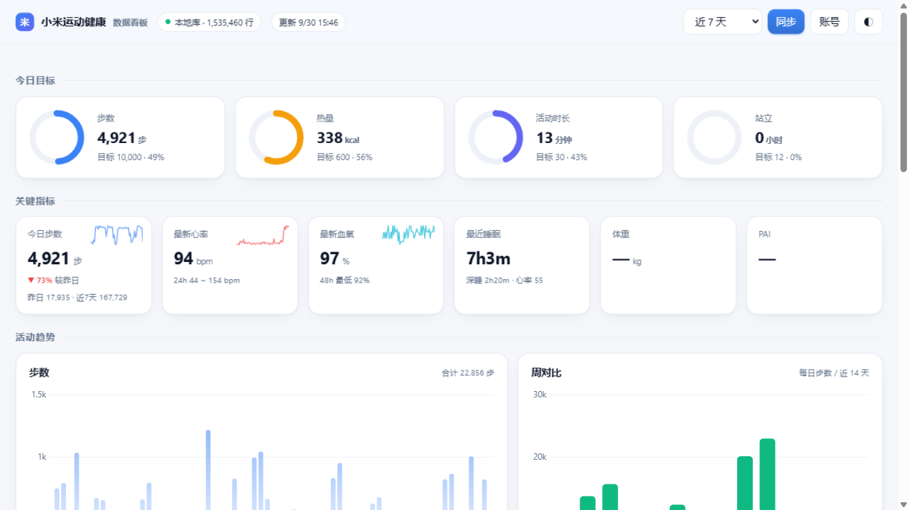
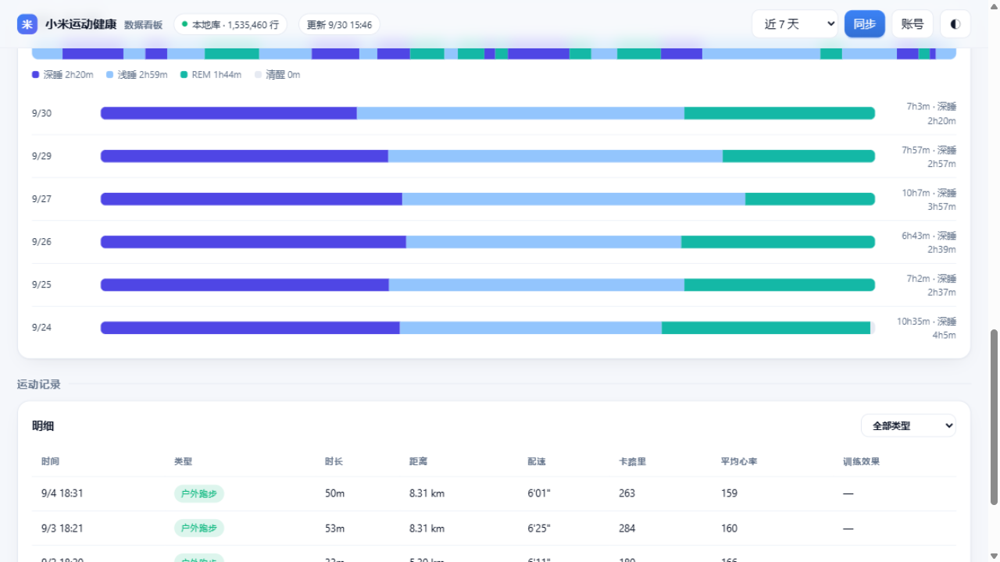
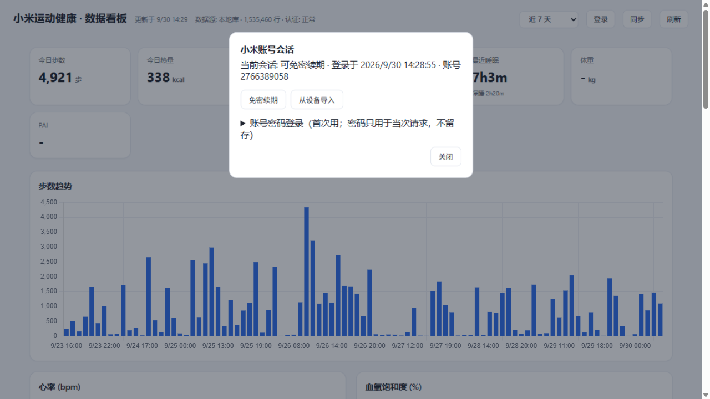

# mihealth-api

小米运动健康（`com.mi.health`，Mi Fitness）个人健康数据工具。

把**自己账号**里的健康数据同步到本地，提供 HTTP 接口与数据看板：
账号登录换取访问凭据 → 按时间窗/增量拉取 → SQLite 归档 → 多维查询与可视化。

[](LICENSE)
[](#)

## 用途

为需要访问**本人**小米运动健康数据的场景提供可编程通道：个人数据备份与导出、接入自建项目/仪表板、与第三方工具（Home Assistant、Obsidian、Grafana 等）做数据集成、接口与数据格式研究。

- 仅供访问**使用者自己账号**名下的数据；需先从自己已登录的 App 提取一次登录凭据（见「登录 / 会话」）
- 与小米公司无任何关联，不是官方开放 API（官方通道为 `pv.hlthopen.io.mi.com`，需注册 OAuth client_id）
- 请遵守适用法律与平台条款使用



看板包含：今日目标环（步数/热量/活动/站立达成率）、关键指标卡（含迷你趋势与较昨日环比）、
步数趋势与周对比、心率/血氧曲线、**睡眠分期时间轴**（深睡/浅睡/REM 逐段着色 + 近 7 晚对比）、
运动记录（类型徽章、配速、训练效果）；支持深/浅色主题与一键同步。睡眠分期配色见下图：



---

## 能力

| 类别 | 内容 |
|---|---|
| 分钟级数据 | 步数、卡路里、心率、血氧、压力、强度活动、站立、耳机噪声 |
| 周期数据 | 睡眠（深睡/浅睡/REM 分期）、PAI、VO2 Max、体重、经期 |
| 医疗/项目 | ECG 等医疗记录、睡眠节律、睡眠日记 |
| 运动 | 记录（服务端类别表 5 类：`outdoor_running` `outdoor_walking` `outdoor_hiking` `e_sports` `physical_training`）× 79 项跑步指标（跑姿/成绩预测/心率区间/训练负荷）、汇总、类别表 |
| 饮食/体重管理 | 饮食记录、食物库、饮食建议、减重计划（接口已通，本账号无数据） |
| 摘要 | 每日目标达成（步数/热量/活动/站立 达成率） |
| 多维查询 | 按数据键 / 时间窗 / 数据源 / 运动类型 / 去重开关，服务端聚合与 CSV 导出 |
| 统计/增量 | `daily_fitness` 统计、watermark 增量锚点与通用水位流 |
| 其它 | 亲友数据、登录态刷新、第三方授权通道 |

- 17 种数据键（CloudKey 全集）× 30+ 端点 × 全量历史翻页
- 交付三件：Python 客户端、Flask HTTP 网关、Web 看板
- 凭证隔离：`config.json` 已 `.gitignore`，不进版本库

## 快速开始

依赖一律走 uv：`uv sync` 建 `.venv`，`uv run` 执行——**不需要手动 `pip install`、不需要 `activate`**（`uv.lock` 已锁定版本，`uv sync --frozen` 可严格按锁文件装）。

```bash
uv sync                                   # 依赖装进 .venv（pycryptodome 提供 RC4 提速 ~40x）

# 放入凭据（提取方法见 API.md §1）
cp config.example.json config.json
uv run mihealth-credentials               # 从 root 设备抓（含 passToken）
uv run mihealth-credentials --db Cookies.db   # 或：离线解析已拷出来的 Cookies 库
# 已有 Cookies 库里的 passToken → uv run mihealth-login --refresh（见「备用：手动提取」）

# 1) 首次全量回填 → SQLite（17 个数据键 + 运动记录 + 每日摘要）
uv run mihealth-sync backfill

# 2) 之后定时增量（水位流 + 时间窗补拉，通常只需个位数请求）
uv run mihealth-sync incremental
uv run mihealth-sync status               # 游标与库内行数

# 3) HTTP 网关 + 看板 → http://127.0.0.1:8567（默认读本地库，无库时走实时接口）
uv run mihealth-api

# 其它
uv run python -m mihealth_api.client      # 客户端冒烟
uv run mihealth-sync export --family fitness --key steps --csv steps.csv
uv run mihealth-export                    # 全量导出 JSON（不落库）
```

五个命令对应 `pyproject.toml` 的 `[project.scripts]`，也可以 `uv run python -m mihealth_api.<模块>` 调用：

| 命令 | 模块 | 作用 |
|---|---|---|
| `mihealth-api` | `mihealth_api.server` | Flask 网关 + 看板 |
| `mihealth-sync` | `mihealth_api.sync` | backfill / incremental / status / export |
| `mihealth-login` | `mihealth_api.login` | 密码登录 / passToken 续期 / 2FA |
| `mihealth-credentials` | `mihealth_api.credentials` | adb 设备或离线 Cookies 库取凭据 |
| `mihealth-export` | `mihealth_api.export` | 全量导出 JSON |

**凭据与数据库按「当前工作目录」解析**（`./config.json`、`./mihealth.db`、`./export/`），
也可用 `--config` / `--db` / `--out`，或环境变量 `MIH_CONFIG` / `MIH_DB` / `MIH_EXPORT_DIR` 覆盖。

### 同步与存储

| 能力 | 说明 |
|---|---|
| 全量回填 | 按时间窗 + `next_key` 游标翻页拉全历史，默认 3 线程并发（`--workers` 可调） |
| 增量同步 | 走**水位变更流**（fitness / sport 各一条，族内向前推进），游标持久化，逐页落库 |
| 时间窗补拉 | 增量时同时补拉最近 `--hours`（默认 72h），修复断档 |
| 去重 | 分页重叠与多数据源（手表/手机）在**物化去重表** `dedup` 收敛为每分钟一条（视图版实测 20~80s/查询，物化后 <0.5s，原始行完整保留在 `records`） |
| 限流 | `--min-interval` 控制请求间隔（默认 0.4s），避免触发风控 |
| 断点续传 | 游标每页落库，中断不丢进度；`INSERT OR REPLACE` 保证重跑幂等 |
| 401 自愈 | 鉴权失败时**先 `passToken` 免密续期**，失败再回落到 adb 重取；成功后**重试当次请求** |

数据库表：`records`（原始行，主键 `family+key+sid+ts`）、`dedup`（写入时维护的物化去重表，主键 `family+key+ts`）、`v_dedup`（指向 `dedup` 的视图）、`sync_state`（游标）。

## 登录 / 会话（三种方式）



网页看板右上角 **登录** 按钮提供三条路径，都不需要每次都碰模拟器：

| 方式 | 说明 | 何时用 |
|---|---|---|
| **账号密码登录** | 用小米账号（手机号/邮箱/ID）+ 密码走 passport 登录，成功后保存 `passToken`。密码只用于当次请求、**不落盘**。支持图片验证码与**短信/邮箱二次验证（2FA）**：面板会提示验证码发到了哪个通道并给出输入框 | 首次接入 |
| **免密续期** | 用已保存的 `passToken` 换新 `serviceToken`，不需要密码/设备。passToken 有效期约 1~2 个月，可反复续期 | 日常（token 过期时自动触发） |
| **从设备导入** | 从已登录 App 的 rooted 设备/模拟器读取会话（含 `passToken`），一条命令完成；也可把 Cookies 库拷到电脑离线解析（见「备用：手动提取」） | 手上已有登录态 |

登完一次之后，网关与同步器在收到 401 时会**自动免密续期并重试**，
实测链路：坏 token → `401 -> refreshed via passToken` → 写回新会话 → 数据正常。

命令行等价：

```bash
uv run mihealth-login --user <小米账号> --password <密码>   # 首次（密码不留存）
uv run mihealth-login --refresh                            # 之后免密续期
uv run mihealth-credentials                                # 从设备导入（含 passToken）
```

> 落盘内容只有 `ssecurity / service_token / cuser_id / user_id / pass_token / session_at`（`config.json`，权限 600）。
> 注意 `ssecurity` **每次会话都会变**，必须与同次会话的 token 配套使用。

**登录实现要点**（与客户端行为保持一致）：

| 环节 | 正确做法 | 错的后果 |
|---|---|---|
| 密码哈希 | **单次 `MD5(password).upper()`** | 用流传的"双重 MD5"会稳定报 `70016 登录验证失败` |
| 客户端伪装 | 登录前设 cookie `sdkVersion=accountsdk-18.8.15` + `deviceId`，UA 形如 `<随机>-AAAAA APP/com.xiaomi.mihome APPV/10.5.201`，第一步带 `userId` cookie | 缺少就被判 `70016` |
| 图片验证码 | 字段名 **`captCode`**；验证码绑定会话，取图与提交必须同一 session | 字段写成 `icode` 无效 |
| **2FA 通道** | 由 `identity/list` 的 **`flag`** 决定：**4=手机短信、8=邮箱**；先 `GET verify{Phone\|Email}?_flag=`，手机通道还需 `POST sendPhoneTicket` 才真正下发 | 固定走邮箱会收到 `{"code":2,"flag":4,"options":[4]}`（要求改用手机） |
| 2FA 的 UA | `identity/*` 是 App 侧端点，UA 必须像米家 App（带 `DeviceId/UserId` 段）+ `deviceId` cookie | 否则返回**空响应体** |
| 响应解析 | 小米响应带 **`&&&START&&&`** 前缀，必须剥离后再 JSON 解析 | 直接 `r.json()` 抛异常 → 被当成"未拿到跳转地址" |
| 完成后 | 提交验证码后**重做一次 `serviceLogin`**（会话已认证，直接返回 `ssecurity`/`passToken`/STS 地址） | — |

海外账号或网络不稳时可在 `config.json` 里配 `proxies`。

### 备用：手动提取

凭据都躺在一个普通 SQLite 库里（`cookies` 表），**不一定需要 Android 环境** ——
关键是拿到那个库：

| 来源 | 做法 |
|---|---|
| root 设备 / 模拟器 | `adb shell su -c "sqlite3 /data/data/com.mi.health/app_webview/Default/Cookies 'select host_key,name,value from cookies'"` |
| 拷到电脑再解析 | 把 `/data/data/com.mi.health/app_webview/Default/Cookies`（连 `-wal`/`-shm` 一起）拉到 PC，用下面的片段读，不依赖 adb 与 root |
| 已有的 Cookies 备份 | Chromium 系的 `Cookies`、`Cookies.db` 都能直接读；整个 `app_webview` 目录、zip 也行 |

```python
import sqlite3
con = sqlite3.connect("file:Cookies?mode=ro&immutable=1", uri=True)
for host, name, value in con.execute(
        "select host_key, name, value from cookies order by host_key, name"):
    print(f"{host}\t{name}\t{value[:40]}")
```

> `value` 为空时真实值在 `encrypted_value`：`v10` 开头是 Chromium 旧版加密
> （`PBKDF2("peanuts", "saltysalt", 1, 16)` 派生密钥、IV 全 `0x20`、AES-128-CBC），可离线解；
> `v20` 开头绑定 App 与设备，离线解不开。带 `-wal`/`-shm` 的库先整组拷走再只读打开，
> 否则可能被锁或读到半截。

| 字段 | 位置 |
|---|---|
| `serviceToken` | `sts-hlth.io.mi.com` 行（长串 base64） |
| `cUserId` | 同一行 |
| `userId` | 同一行（**续期时必需**，见下） |
| `ssecurity` | `.wear.mi.com.internal.yrn.net` 行 |
| `passToken` | `.account.xiaomi.com` 行（免密续期用） |

`.hlth.io.mi.com` 行的 `serviceToken` 值为 `miothealth`，是 sid 标记，不参与认证。

**两个必踩的坑：**

1. **Cookie 库里躺着的 `serviceToken` 基本一定过期了**，直接拿去请求会 `401 auth failed`。
   这不是提取错了，是快照本来就旧。只要同一份库里还有 `passToken`，`uv run mihealth-login --refresh`
   就能换新票，不需要密码、不需要设备。
2. **换票报 `70016 登录验证失败` 时先查 `userId` 有没有带上。** `passToken` 换票要求 cookie 里
   `passToken / cUserId / userId` 三件齐全，`userId` 是空串时 passport 直接回 70016，
   **与「票真的过期」返回码完全相同**，极容易误判成 passToken 失效而去走密码+2FA 重登。
   把 `sts-hlth.io.mi.com` 行的 `userId` 一并写进 `config.json` 再试；能成功就说明票没坏。

`ssecurity` 与 `serviceToken` 必须**同批**写入 —— 续期会同时刷新两者，只更新其中一个必然签名失败。

## 接口文档

接口层面的内容全部在 [API.md](API.md)，README 只留入口：

| API.md | 内容 |
|---|---|
| §1–6 | 小米云端 `hlth.io.mi.com/app/v1/` 原生接口：认证四件套、RC4 签名协议、端点目录、账号登录、凭证刷新、附加数据族 |
| §7 | 本仓库 `mihealth_api/server.py` 的**本地网关**：`/api/*` 全部路由、多维查询与服务端聚合用法 |
| §8 | `mihealth_client.py`（即 `mihealth_api/client.py`）的 Python 调用示例 |
| §9 | 数据真实性说明（单位、增量值、睡眠分期编码、多数据源） |

本地网关常用入口（`uv run mihealth-api` 之后）：

```
GET  /api/health              认证状态 + 存储模式 + 行数
GET  /api/overview            今日摘要
GET  /api/families            数据清单：family/key 行数、时间范围、数据源
GET  /api/db/<family>         多维查询：key × 时间窗 × 数据源 × 去重开关 × 排序
GET  /api/agg/<family>/<key>  服务端聚合：内层字段 × sum/max/min/avg × 任意桶宽
GET  /api/export.csv          任意族/键导出 CSV
GET  /                        数据看板（含同步按钮与登录面板）
```

响应统一 `{ok, items, count, has_more}`。

数据键共 17 种：`steps` `calories` `sleep` `heart_rate` `stress` `spo2` `intensity`
`valid_stand` `energy` `goal` `pai` `blood_pressure` `blood_sugar` `headset` `weight`
`vo2_max` `menstruation`（逐键返回结构见 API.md §4.1）。

## 目录

```
src/mihealth_api/
  __init__.py        # 包入口 + 公开 API（MiHealthClient / Store / load_config ...）
  client.py          # Python 客户端 + crypto（签名/RC4/重试/限流/去重/水位/401 自愈）
  login.py           # 小米账号登录（passport→STS）：密码 / passToken 免密 / 2FA
  credentials.py     # 凭据重取：adb 设备（base64 避开 pty）或离线 Cookies 库
  store.py           # SQLite 存储层（幂等 upsert + 物化去重表 + 游标）
  sync.py            # 同步编排器：backfill / incremental / status / export
  server.py          # Flask HTTP 网关（看板 + REST 代理 + 登录接口，库优先·实时回退）
  auth.py            # 401 自愈：passToken 优先，adb 兜底
  export.py          # 全量导出 JSON
  paths.py           # 配置/库/导出目录解析（cwd + 环境变量）
  static/            # index.html + Chart.js + 看板截图（随包分发）
tests/               # 单元测试（pytest，无网络）
tools/
  dump_tokens.js     # Frida hook 现场抓 token（需手动装到设备）
API.md               # 接口文档（认证/协议/端点/网关/客户端/数据口径）
NOTES.md             # 接口与数据结构笔记
config.example.json  # 凭据模板
pyproject.toml       # 依赖、构建与控制台脚本（uv 管理，Python >=3.14）
uv.lock              # 锁定版本，复现用 uv sync --frozen
.python-version      # 3.15
```

## 实现说明

- 数据来自小米运动健康账号的云端服务（`hlth.io.mi.com`），凭证为登录态 Cookie
- 请求签名与加密按客户端行为实现：`nonce`（随机 + 分钟时间戳）→ `SHA256` 会话密钥 → `RC4`（丢弃前 1024 字节）
- 接口清单、参数与数据结构见 [API.md](API.md)；实现陷阱见 §2.4、接口实测语义见 §4.5、单位与口径见 §9
- 只读使用：本工具不修改账号数据（仅同步/查询）

## License

GPL-3.0-or-later。仅供个人数据访问与研究用途。
